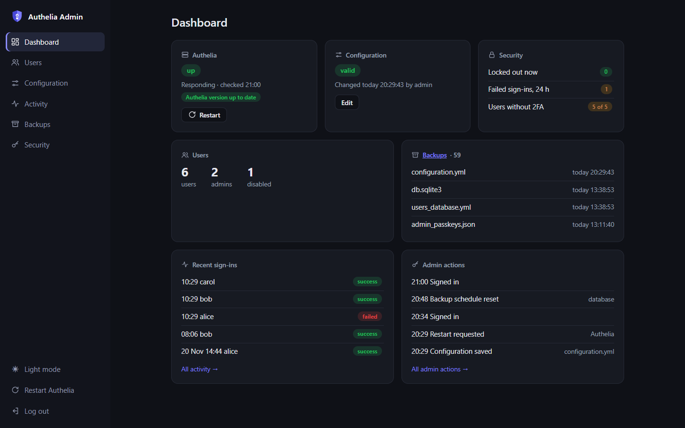
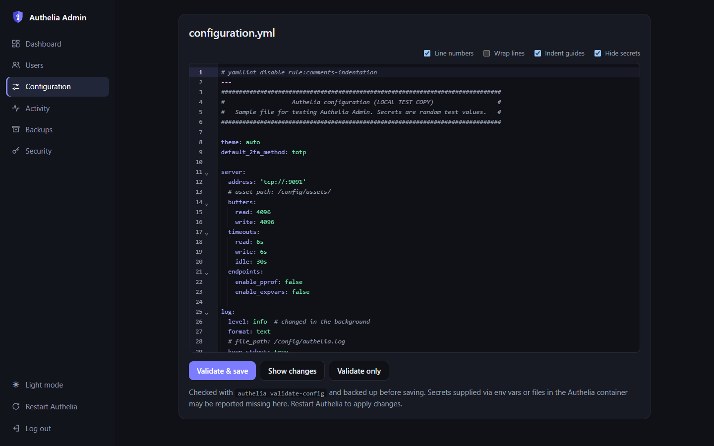
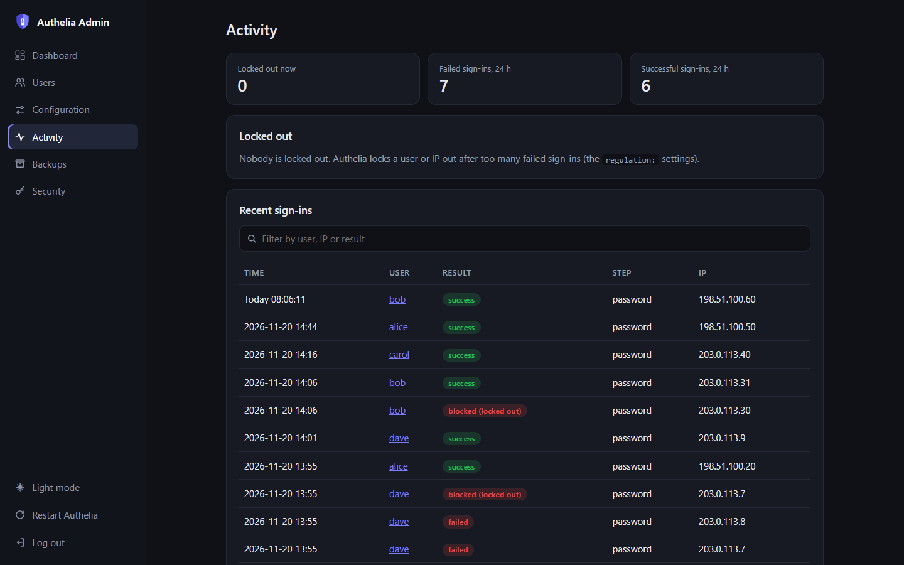
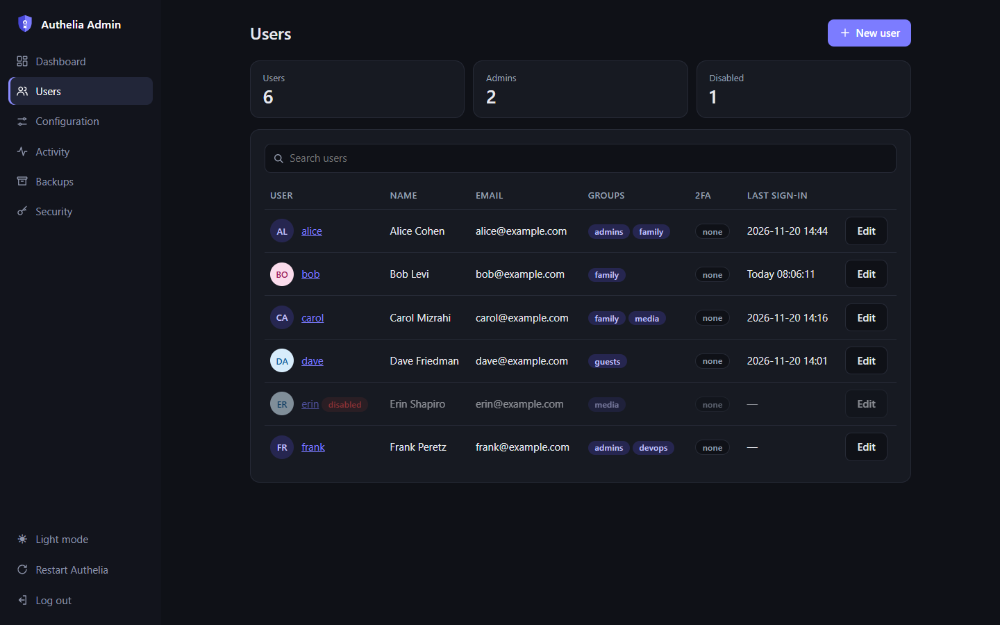
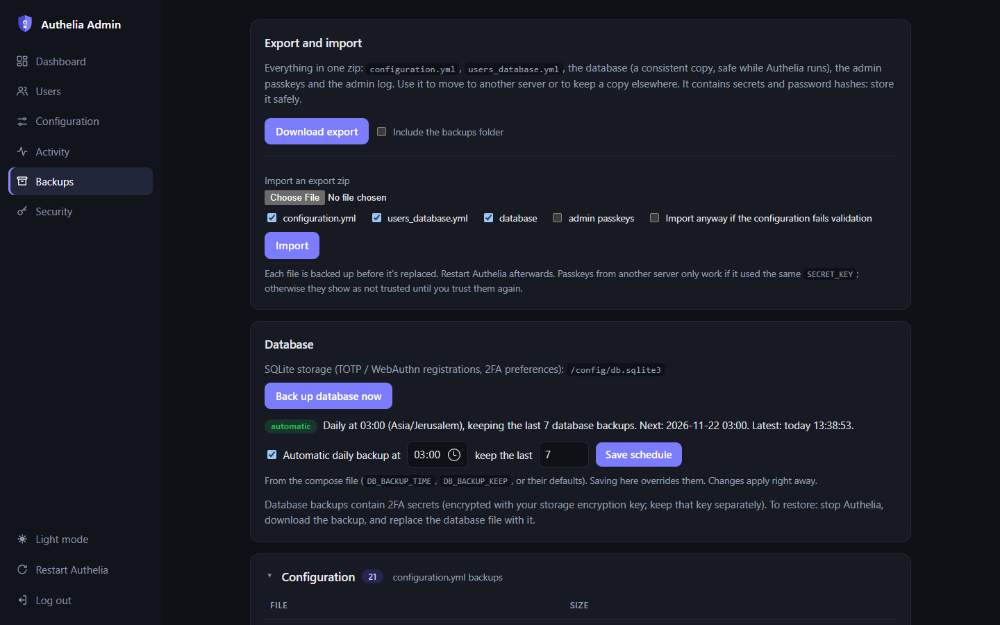

<p align="center">
  <picture>
    <source media="(prefers-color-scheme: dark)" srcset="https://raw.githubusercontent.com/ShlomiD83/Authelia-Admin/main/docs/logo-dark.svg">
    
  </picture>
</p>

A small, self-hosted web UI for managing an [Authelia](https://www.authelia.com/) instance that uses the
**file user backend** and **SQLite storage**: users, passwords, `configuration.yml`, backups and 2FA resets, from your browser (phone included).

Runs as a single container with a distroless runtime image and no pinned Authelia version. A prebuilt multi-arch image for **amd64 and arm64** is published on Docker Hub as [`romekd/authelia-admin`](https://hub.docker.com/r/romekd/authelia-admin) and on GHCR as [`ghcr.io/shlomid83/authelia-admin`](https://github.com/ShlomiD83/Authelia-Admin/pkgs/container/authelia-admin). It is developed on a Raspberry Pi (arm64), and every build is smoke-tested on both architectures before it is published.

## Screenshots

<p align="center">
  
</p>

| Configuration editor | Activity |
|---|---|
|  |  |
| **Users** | **Backups** |
|  |  |

## Features

**Dashboard**
- Home page with the state of everything at a glance: Authelia up or down, configuration valid or not and when it last changed, lockouts, failed sign-ins, users without 2FA, user counts, latest backups, and the most recent sign-ins and admin actions

**Users**
- Create, edit (display name, email, groups, disabled) and delete users in `users_database.yml`
- Set or generate passwords, hashed with argon2id in Authelia's own format (t=3, m=64 MiB, p=4); plain passwords are never stored
- Per-user **Reset 2FA**: removes TOTP and WebAuthn registrations from Authelia's SQLite database through the Authelia CLI
- Search, stats and avatars on the Users page

**Configuration**
- Edit `configuration.yml` in the browser; YAML syntax check plus `authelia validate-config` before saving
- Code editor (CodeMirror) with YAML highlighting, search (Ctrl+F), folding, and switches for line numbers, line wrapping and indent guides (remembered per browser)
- Autocomplete and hover docs from Authelia's own configuration schema (the one matching the Authelia release in the image): option names, allowed values and descriptions, plus live warnings for unknown options and invalid values; Ctrl+Space shows suggestions, Ctrl+S validates and saves
- Problems marked on the line itself: YAML syntax errors as you type, and Authelia's validation errors and warnings after Validate or Save (hover for the message, or click the problems counter for the list)
- Unsaved edits are kept in your browser, so they survive an expired session or a closed tab; the editor offers to restore them
- A "Modified" marker and a "Leave site?" prompt while edits are unsaved
- Secrets (`jwt_secret`, `encryption_key`, client secrets, private keys, ...) blurred on screen until the cursor is in them
- A notice as soon as `configuration.yml` is changed elsewhere while you edit
- Activity page: recent sign-ins, failed attempts and current lockouts from Authelia's database, with Unban; the Users page shows each user's 2FA methods and last sign-in
- Admin action log: every change made through this app (and admin sign-ins) with time, IP and details, shown on the Activity page
- Open a configuration backup in the editor to review, adjust and save it with validation
- Won't silently overwrite changes made elsewhere: if `configuration.yml` changed on disk (for example over SSH) after you opened the page, Save stops and shows the difference, and you choose to load the current file or overwrite it
- **Show changes**: diff of your edit against the current file before you save- Optional **Restart Authelia** button (no Docker socket needed, see [Restart button](#restart-authelia-from-the-ui)), with a live status that confirms Authelia came back up

**Backups**
- Automatic timestamped backup on every save, restore and delete, grouped by category (Configuration, Users, Database)
- "Back up database now": consistent online SQLite backup, with download and delete
- **Automatic daily database backup** (default 03:00, keeping the last 7), with a catch-up run after downtime; time, on/off and how many to keep can be changed on the Backups page (or with `DB_BACKUP_TIME` / `DB_BACKUP_KEEP`)
- Backup view shows exactly what a restore would change; old backups are pruned (`MAX_BACKUPS`)
- **Export and import**: download `configuration.yml`, `users_database.yml`, the database (a consistent copy), the admin passkeys and the admin log as one zip (optionally with the backups folder), and import chosen parts from such a zip; the configuration is validated first and every replaced file is backed up

**Security**
- Admin login with CSRF protection, login rate limit (5 attempts, 15 minutes), strict cookies and a strict CSP
- **Sign-out after inactivity** (default 30 minutes, `ADMIN_IDLE_TIMEOUT`), with a warning and **Stay signed in** a minute before; background refreshes don't count as activity, and several open tabs stay in sync
- **Passkeys** (WebAuthn) for the admin login, managed on the Security page
- **TOTP** second step for password login, with QR-code setup
- `/healthz` endpoint and a Docker `HEALTHCHECK`

**Interface**
- Sidebar dashboard layout, automatic dark mode with a manual toggle, mobile-friendly

## Requirements

- Docker with Compose
- An Authelia instance using the file backend (`users_database.yml`) and, for Reset 2FA and database backups, SQLite storage
- Access to the **same folder** Authelia uses for its configuration (`configuration.yml`, `users_database.yml`, `db.sqlite3`)
- HTTPS in front of the UI if you want passkeys (browsers only allow them on HTTPS)

## Quick start

1. Clone the repository and generate a session secret and an admin password hash (see [How-to](#how-to)):

   ```bash
   openssl rand -hex 32
   ```

2. Edit `docker-compose.yml`: set the config folder, `user:`, `ADMIN_USER`, `SECRET_KEY` and the password.
3. Build and start:

   ```bash
   docker compose up -d --build
   ```

4. Open `http://127.0.0.1:8080` (or your reverse proxy address) and sign in.

Minimal compose file:

```yaml
services:
  authelia-admin:
    build: .
    image: authelia-admin:latest
    container_name: authelia-admin
    restart: unless-stopped
    ports:
      - "127.0.0.1:8080:8080"
    environment:
      ADMIN_USER: admin
      ADMIN_PASSWORD_HASH: '$$argon2id$$v=19$$m=65536,t=3,p=4$$...'   # every $ doubled; see How-to
      SECRET_KEY: "output-of-openssl-rand-hex-32"
      COOKIE_SECURE: "true"          # "false" only for plain-HTTP testing
      TZ: UTC                        # e.g. Europe/London, used for backup file names
    volumes:
      - /path/to/authelia:/config    # the folder Authelia itself uses
    user: "1001:100"                 # a UID:GID that can write that folder
```

The container user must be able to **write** the config folder. Check the owner with `ls -ln /path/to/authelia` and set `user:` to match.

## Environment variables

### Admin login

| Variable | Default | Description |
|---|---|---|
| `ADMIN_USER` | `admin` | Admin username. |
| `ADMIN_PASSWORD` | – | Admin password in plain text. Simple, but the password sits in your compose file. |
| `ADMIN_PASSWORD_HASH` | – | Admin password as an argon2id hash. Takes precedence over `ADMIN_PASSWORD`. In compose YAML every `$` must be written as `$$`. |
| `ADMIN_PASSWORD_HASH_FILE` | – | Path to a file containing the hash (no `$` escaping needed). Overrides `ADMIN_PASSWORD_HASH`. |
| `ADMIN_IDLE_TIMEOUT` | `30` | Minutes without activity (page loads, actions, typing or clicking) before the admin is signed out; a warning appears a minute before. `0` turns it off. |
| `SECRET_KEY` | random per start | Signs the session cookie and each stored passkey. **Set it**, otherwise every restart logs you out and passkeys aren't protected against changes made outside the app. Use a long random value. Changing it later makes existing passkeys "not trusted" until you trust them again on the Security page. |
| `COOKIE_SECURE` | `false` | Set to `true` when served over HTTPS. With `true` over plain HTTP, login fails with "Bad CSRF token". |
| `TZ` | `UTC` | Time zone (IANA name) for backup file names and timestamps. |

One of `ADMIN_PASSWORD`, `ADMIN_PASSWORD_HASH` or `ADMIN_PASSWORD_HASH_FILE` is required; the container refuses to start without one. A hash that does not start with `$argon2` also stops the start (usually a sign of missing `$$` escaping).

### Paths

| Variable | Default | Description |
|---|---|---|
| `AUTHELIA_CONFIG_DIR` | `/config` | Where the Authelia folder is mounted inside the container. |
| `AUTHELIA_CONFIG_FILE` | `configuration.yml` | Authelia configuration file name, relative to the config dir. |
| `AUTHELIA_USERS_FILE` | `users_database.yml` | Users file name, relative to the config dir. |
| `AUTHELIA_DB_FILE` | `<config dir>/db.sqlite3` | SQLite file, used only if `storage.local.path` is not set in the configuration. |
| `MAX_BACKUPS` | `30` | Backups kept per file (configuration and users); older ones are deleted. |
| `DB_BACKUP_TIME` | `03:00` | Time of the automatic daily database backup, in `TZ`; `off` turns it off. If the container was down at that time and the last database backup is over a day old, one runs shortly after start. A schedule saved on the Backups page takes precedence. |
| `DB_BACKUP_KEEP` | `7` | Database backups kept (automatic and manual together); older ones are deleted. A value saved on the Backups page takes precedence. |
| `ACTIVITY_DAYS` | `30` | How many days back the Activity page shows sign-ins and admin actions. |
| `AUDIT_LOG_FILE` | `/config/admin_audit.log` | Where the admin action log is written (JSON lines, about 1 MB plus one older `.1` file). |

Backups are stored in `<config dir>/backups`.

### Reset 2FA and validation

Any other `AUTHELIA_*` variable you set on this container (for example `AUTHELIA_STORAGE_ENCRYPTION_KEY` or `AUTHELIA_STORAGE_ENCRYPTION_KEY_FILE`) is passed to the Authelia CLI. Reset 2FA needs the same storage encryption key Authelia uses, if the key is not written in `configuration.yml`, and `db.sqlite3` reachable at `storage.local.path`. The app's own `AUTHELIA_*` variables above are hidden from the CLI so it does not warn about them.

### Passkeys

| Variable | Default | Description |
|---|---|---|
| `ADMIN_RP_ID` | – | Your site's domain, for example `admin.example.com`. Passkeys are bound to it. |
| `ADMIN_ORIGIN` | – | Full origin, for example `https://admin.example.com`. |
| `ADMIN_RP_NAME` | `Authelia Admin` | Name shown in the passkey prompt and authenticator apps. |
| `PASSKEY_FILE` | `<config dir>/admin_passkeys.json` | Where public keys and counters are stored (private keys never leave your device). Each entry is signed with a key derived from `SECRET_KEY`; an entry added or changed outside the app is ignored for sign-in until a signed-in admin trusts it. |
| `ADMIN_PASSKEY_ONLY` | `false` | `true` turns password login off while at least one passkey is registered. |

Passkeys are enabled when both `ADMIN_RP_ID` and `ADMIN_ORIGIN` are set.

### TOTP

| Variable | Default | Description |
|---|---|---|
| `ADMIN_TOTP_SECRET` | – | Base32 secret. When set, password login also asks for a 6-digit code. Passkey login skips it. |

### Restart button

| Variable | Default | Description |
|---|---|---|
| `RESTART_FLAG_FILE` | – | Enables the Restart button in flag-file mode (recommended): the button creates this file, for example `/config/.restart-request`, and a host service restarts Authelia. |
| `AUTHELIA_CONTAINER` | – | Name of the Authelia container. Enables the Restart button through the Docker API (a socket proxy, or the Docker socket). If both are set, the Docker API is tried first and the flag file is the fallback. |
| `DOCKER_HOST` | Docker socket | Where the Docker API is, for example `tcp://socket-proxy:2375` for a socket proxy. Only used with `AUTHELIA_CONTAINER`. |
| `AUTHELIA_URL` | – | Authelia's address as this container reaches it, for example `http://authelia:9091` (same Docker network) or `http://192.168.1.10:9091`. After a restart the page checks Authelia's `/api/health` and reports when it is back up, or that it didn't come back. Without it, the page only confirms that the host picked up the restart request. A request the host doesn't pick up within 20 seconds is withdrawn, so Authelia can't restart later by surprise. |
| `UPDATE_CHECK` | `true` | The dashboard asks GitHub (at most every 6 hours, no personal data) for Authelia's latest release and says when it's newer than the Authelia built into this image, so you know to pull a new admin image. `false` turns it off. |

### Reverse proxy

| Variable | Default | Description |
|---|---|---|
| `TRUST_PROXY` | `0` | Number of reverse proxies in front of the app. Makes the login lockout count real client addresses from `X-Forwarded-For`. Enable only if the proxy is the **only** way to reach the container. |

## How-to

### Generate an admin password hash

```bash
read -rs -p "Admin password: " PW; echo
docker run --rm --entrypoint /usr/local/bin/authelia authelia-admin:latest crypto hash generate argon2 --password "$PW" | sed 's/^Digest: //; s/\$/$$/g'; unset PW
```

Run it after `docker compose build` (the image is named `authelia-admin:latest` in the example compose file; adjust if you renamed it). The output already has every `$` doubled; paste it in single quotes as `ADMIN_PASSWORD_HASH`.

To avoid escaping altogether, write the hash (without the `Digest: ` prefix) into a file, mount it, and set `ADMIN_PASSWORD_HASH_FILE`.

### Enable TOTP

1. Sign in, open **Security**, click **Set up authenticator**.
2. Scan the QR code (or type the key), enter the code your app shows, click **Verify code**.
3. Add the shown line to the environment and recreate the container:

   ```yaml
   ADMIN_TOTP_SECRET: "THE-SECRET-SHOWN"
   ```

To turn it off, remove the variable and recreate the container.

### Enable passkeys

1. Serve the UI over HTTPS on a real domain and set `ADMIN_RP_ID` and `ADMIN_ORIGIN` to it. Changing the domain later invalidates existing passkeys.
2. Recreate the container, open **Security**, click **Add passkey** and follow the prompt.
3. Register at least two (for example a phone and a security key).
4. Optional: set `ADMIN_PASSKEY_ONLY: "true"` to switch off password login. This only applies while a passkey exists, so deleting all passkeys never locks you out.

### Restart Authelia from the UI

**Flag file (recommended, no Docker access for the container).** The button creates a request file in your Authelia folder, and a systemd unit on the host restarts the Authelia container when it appears.

The easy way: run the install script on the Docker host, with your Authelia folder (the one mounted as `/config`):

```bash
curl -fsSLO https://raw.githubusercontent.com/ShlomiD83/Authelia-Admin/main/scripts/install-restart-service.sh
sudo bash install-restart-service.sh --folder /path/to/authelia
```

It finds the Authelia container by itself (the container made from the `authelia/authelia` image); if you run several, it lists them and you pick one with `--container <name>`. It creates, enables and starts the units below, checks the folder, container and systemd first, and removes an old unanswered request so nothing restarts by surprise. `--dry-run` shows what it would write without changing anything; `--uninstall` removes it. Then set `RESTART_FLAG_FILE: /config/.restart-request` in the admin container's compose file and recreate it.

Or by hand: set `RESTART_FLAG_FILE: /config/.restart-request` and create a systemd path unit that reacts to the file (adjust the path to your Authelia folder and the container name):

`/etc/systemd/system/authelia-restart.path`

```ini
[Unit]
Description=Watch for Authelia restart requests
[Path]
PathExists=/path/to/authelia/.restart-request
Unit=authelia-restart.service
[Install]
WantedBy=multi-user.target
```

`/etc/systemd/system/authelia-restart.service`

```ini
[Unit]
Description=Restart Authelia container
[Service]
Type=oneshot
ExecStartPre=/bin/rm -f /path/to/authelia/.restart-request
ExecStart=/usr/bin/docker restart authelia
```

```bash
sudo systemctl daemon-reload && sudo systemctl enable --now authelia-restart.path
```

**Socket proxy.** If you run a Docker socket proxy, the app can restart Authelia through it. Set `AUTHELIA_CONTAINER` and `DOCKER_HOST`, put both containers on a shared network, and allow only the two requests the app makes. With [wollomatic/socket-proxy](https://github.com/wollomatic/socket-proxy):

```yaml
  socket-proxy:
    image: wollomatic/socket-proxy:1
    restart: unless-stopped
    user: "65534:<docker group id>"   # stat -c %g /var/run/docker.sock
    read_only: true
    cap_drop: [ALL]
    security_opt: [no-new-privileges]
    volumes:
      - /var/run/docker.sock:/var/run/docker.sock:ro
    command:
      - -listenip=0.0.0.0
      - -allowfrom=authelia-admin
      - -allowGET=^/version$
      - -allowPOST=^/v1\.[0-9]+/containers/authelia/restart$
    networks: [socket-proxy]

  authelia-admin:
    environment:
      AUTHELIA_CONTAINER: authelia
      DOCKER_HOST: tcp://socket-proxy:2375
      RESTART_FLAG_FILE: /config/.restart-request   # optional fallback, see below
    networks: [socket-proxy]   # plus the networks it already uses
```

Replace `authelia` in `-allowPOST` with your Authelia container name. The proxy then refuses everything else, including restarting other containers.

**Both (proxy first, flag file as fallback).** Set `AUTHELIA_CONTAINER`, `DOCKER_HOST` and `RESTART_FLAG_FILE`, and keep the host service. The app restarts through the proxy; if that fails (proxy down, request refused, container not found), it creates the request file instead, shows a warning with the reason, and the host service restarts Authelia. The admin log records which way was used.

**Docker socket (not recommended).** Set `AUTHELIA_CONTAINER`, mount `/var/run/docker.sock` and add `group_add` with the socket's group id (`stat -c %g /var/run/docker.sock`). This gives the container root-equivalent access to the host.

### Restore from a backup

- **Configuration and users:** Backups page, open the file, review "Changes if restored", click **Restore**. The current file is backed up first.
- **Database:** download the backup, stop Authelia, replace the SQLite file, start Authelia. Database backups contain 2FA secrets (encrypted with your storage encryption key); keep that key separately.

### Put it behind a reverse proxy

Terminate TLS at your proxy and forward to the container (`http://authelia-admin:8080` on a shared Docker network, or `127.0.0.1:8080`). Set `COOKIE_SECURE: "true"`. If the proxy is the only path to the container, you can set `TRUST_PROXY: "1"` for a per-client login lockout.

## Updating

See [CHANGELOG.md](CHANGELOG.md) for what changed in each build.

```bash
git pull
docker compose build --pull
docker compose up -d --force-recreate
```

The image compiles the Authelia CLI from the latest `v4.x` release tag at build time (no version is pinned), so a rebuild picks up new Authelia releases and base-image patches. Use `--no-cache` to force a fresh Authelia build. On a Raspberry Pi the first build is slow because of the Go toolchain; later builds reuse the cache.

Multi-architecture build and push:

```bash
docker buildx build --platform linux/amd64,linux/arm64 -t youruser/authelia-admin:latest --push .
```

## Prebuilt image (GitHub Actions)

You don't have to build anything: use the published image in compose and drop the `build: .` line.

```yaml
    image: romekd/authelia-admin:latest
    # or the same image from the GitHub Container Registry:
    # image: ghcr.io/shlomid83/authelia-admin:latest
```

`.github/workflows/docker.yml` builds the image for amd64 (on an amd64 runner) and arm64 (on a native arm64 runner) and publishes the same multi-arch tags to Docker Hub and to the GitHub Container Registry (ghcr.io):

- the **Run workflow** button on the Actions tab (or `gh workflow run docker.yml`) rebuilds `latest` with the newest Authelia release and base-image security patches
- pushing a version tag such as `v1.2.3` also runs it and publishes `latest`, `1.2.3` and `1.2`
- the weekly CVE check (below) runs it when the published image has fixable vulnerabilities

To use it in your own fork, add a repository variable `DOCKERHUB_USERNAME` (your Docker Hub user name) and a repository secret `DOCKERHUB_TOKEN` (a Docker Hub access token with Read and Write scope), under Settings > Secrets and variables > Actions. The image is published as `<your Docker Hub user>/authelia-admin` and `ghcr.io/<your GitHub user>/authelia-admin`; GHCR needs no secret (the workflow's own token is used). A new GHCR package starts out private: make it public once under your GitHub profile > Packages > authelia-admin > Package settings > Change visibility. Then use it in compose instead of building:

```yaml
    image: youruser/authelia-admin:latest   # remove the "build: ." line
```

The free native arm64 runner is available for public repositories. In a private repository, switch the arm64 runner to one you have access to, or use QEMU emulation (much slower).

## Automatic security updates

`.github/workflows/cve-check.yml` runs every Monday:

1. scans the published `latest` image (amd64 and arm64) with Docker Scout for vulnerabilities that already have a fix
2. if it finds any, rebuilds and publishes the image, which pulls the patched base images and the latest Authelia release and Go libraries
3. scans the new image again; the run fails (and GitHub emails you) if fixable vulnerabilities remain, usually because the fix hasn't reached the base images yet

You can also start it from the Actions tab, with an option to force a rebuild.

Python packages are pinned in `requirements.txt`, and the editor's packages (CodeMirror, esbuild) in `editor/package-lock.json`. Dependabot (`.github/dependabot.yml`) opens weekly pull requests for them and for the GitHub Actions versions. Nothing is merged automatically: `.github/workflows/dependabot-check.yml` builds the image once as a check, then labels the pull request and mentions you in a comment (patch, minor or major, and whether the test passed), so GitHub notifies you. Review and merge it yourself, then run the image workflow to publish Python or editor updates.

Every build overwrites only `latest`; it also gets its own tag with the build date and time in UTC, for example `romekd/authelia-admin:2026.11.18-1408`, which is never overwritten. To control when your server updates, use a date tag instead of `latest` and move it forward after checking the new image.

**Smoke test.** Before anything is published, each platform image is started with the sample data in `tests/fixtures` and checked by `tests/smoke-test.sh`: sign-in, every page, validation with the built-in Authelia CLI, saving the configuration and a user, setting a password, backups and the admin log. If any check fails, nothing is pushed. Dependabot pull requests run the same test before you are notified. Run it locally with `bash tests/smoke-test.sh <image>` (needs Docker, curl and openssl; works in Git Bash on Windows).

**Cleanup.** After each build, only the images behind the newest 3 tags are kept (`latest` is always the newest); older ones are deleted. To clean up Docker Hub without a build, run the **Docker Hub cleanup** workflow from the Actions tab (it asks how many images to keep, default 3). On GHCR, untagged leftovers are removed too, safely for multi-arch images. Docker Hub cleanup needs a Docker Hub access token with **Read, Write & Delete** scope in a repository secret named `DOCKERHUB_CLEANUP_TOKEN` (the build token only needs Read & Write); without it, that step is skipped. Untagged images on Docker Hub aren't removed (public repositories aren't charged for storage).

GitHub pauses scheduled workflows in repositories with no activity for 60 days (it emails you first); re-enable it from the Actions tab if that happens.

## Security notes

- This UI can reset any user's password and edit your Authelia configuration. Keep it on a trusted network (LAN or VPN) behind HTTPS; do not expose it directly to the internet.
- Prefer passkeys and/or TOTP, and a strong `SECRET_KEY`.
- The runtime image is Chainguard's distroless Python (no shell, no package manager). The app runs as the non-root user you set with `user:`.
- Authelia's file backend watches `users_database.yml` (`authentication_backend.file.watch: true`), so user changes apply immediately. Configuration changes need an Authelia restart.
- `authelia validate-config` may report secrets that Authelia receives through environment variables or files as missing, because this container does not have them. Use "Save anyway" if that is the only complaint.

## Troubleshooting

| Symptom | Cause and fix |
|---|---|
| "Bad request: Bad CSRF token" | `COOKIE_SECURE: "true"` while using plain HTTP. Use HTTPS or set it to `false`. |
| "Invalid credentials" with a hash | The `$` signs were not doubled (`$$`) in compose. Use the command above or `ADMIN_PASSWORD_HASH_FILE`. |
| Everyone is logged out after a restart | `SECRET_KEY` is not set. |
| `TemplateNotFound` / Internal Server Error | Source folders are not readable by the container user (for example mode `0500`). Run `chmod -R u+rwX,go+rX app` and rebuild. |
| Passkey button missing or fails | Needs `ADMIN_RP_ID` and `ADMIN_ORIGIN`, HTTPS, and the exact domain in the address bar. |
| "Restart failed" | The Docker API restart didn't work; the message says why (proxy unreachable, request refused, wrong container name, or no socket). Add `RESTART_FLAG_FILE` as a fallback, or use the flag-file mode. |
| Reset 2FA fails | `db.sqlite3` not at `storage.local.path`, or the storage encryption key is not available to this container. |

## Project layout

```
Dockerfile            multi-stage build (Authelia CLI + schema, Python deps, editor bundle, distroless runtime)
docker-compose.yml    example deployment
requirements.txt      pinned Python dependencies
CHANGELOG.md          what changed in each build
app/app.py            Flask application
app/templates/        Jinja templates
app/static/app.js     browser-side code for every page (the CSP forbids inline scripts)
editor/               configuration editor (CodeMirror), bundled into app/static/editor.js at build time;
                      versions pinned in editor/package-lock.json
scripts/              install-restart-service.sh: host side of the Restart button (systemd units)
tests/                smoke-test.sh and its sample data, run by CI before each image is published
```

## License

[MIT](LICENSE)
